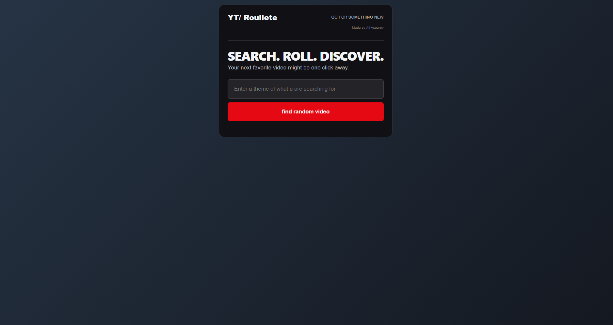
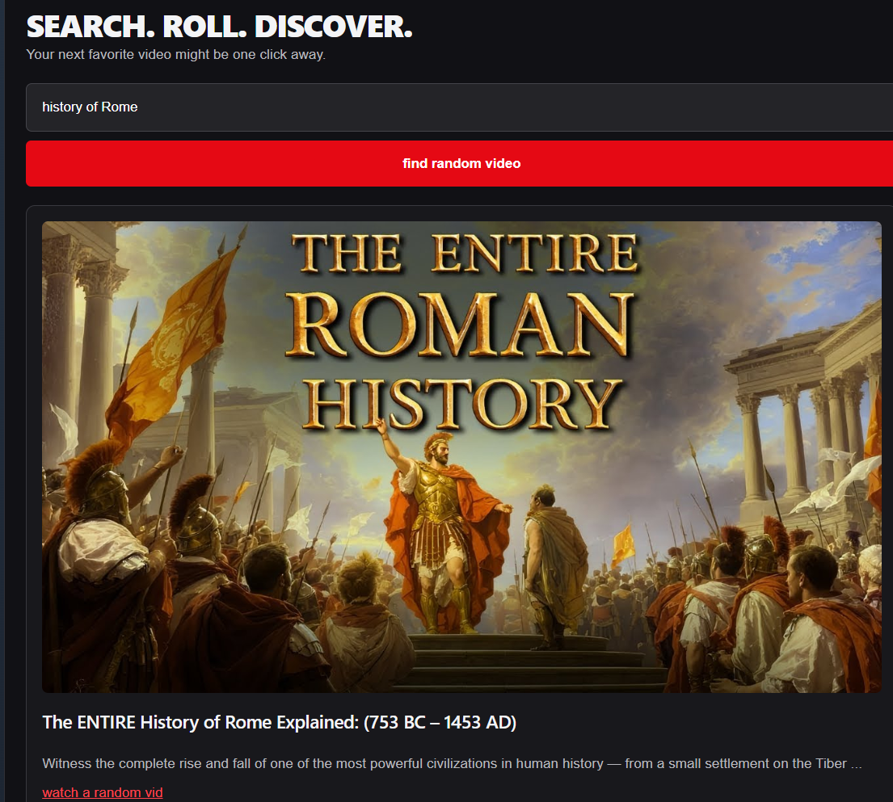

# YouTube Roulette

A full-stack web application that searches YouTube and randomly
recommends a video based on the user's search keyword.

## Features

- Search YouTube using custom keywords
- Random video selection
- Exclude videos that are 3 minutes or shorter
- Display thumbnails, titles, descriptions, and channel names
- Open selected videos directly on YouTube
- Input validation and error handling
- Responsive user interface

## Tech Stack

**Backend:** Java 21, Spring Boot, Maven

**Frontend:** React, JavaScript, Vite, CSS

**External API:** YouTube Data API v3

## Installation and Setup

## Installation and Setup

### Prerequisites

- Java 21
- Maven
- Node.js and npm
- YouTube Data API v3 API key

### 1. Configure the API key

Create an environment variable named `youtube_api_key`
containing your YouTube Data API key.

Never commit your API key to GitHub.

### 2. Start the backend

Open the project in IntelliJ IDEA.

Run `YoutubeRouletteApplication.java`.

The Spring Boot backend runs at:
http://localhost:8080

### 3. Start the frontend

Open a terminal in the project folder and run:

```bash
cd frontend
npm install
npm run dev
```

### 4. Open the application

Visit http://localhost:5173 in your browser.

Both the frontend and backend must be running.
## How It Works
1. The user enters a search keyword in the React frontend.
2. React sends an HTTP GET request to the Spring Boot backend.
3. The backend calls the YouTube Data API v3 to retrieve up to five matching videos.
4. A second API request retrieves the durations of those videos.
5. Videos that are three minutes or shorter are filtered out.
6. The backend randomly selects one of the remaining videos.
7. The selected video's title, description, channel name, thumbnail URL, and video URL are returned as JSON.
8. React displays the video information in a preview card.
9. Clicking the thumbnail or link opens the video on YouTube.
10. ### Error Handling

- HTTP 400: Empty search keyword.
- HTTP 404: No eligible videos found.
- HTTP 502: YouTube API returned an unsuccessful or unexpected response.

The YouTube API key is stored in a server-side environment
variable and is never sent to the React frontend.
## Screenshots
### Homepage



### Random Video Result

